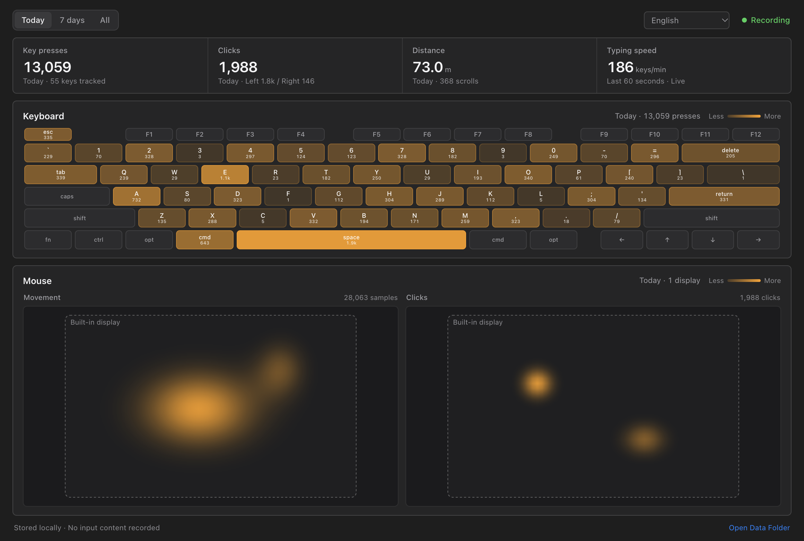

# KeyGlow

**English** · [简体中文](README.zh-CN.md)

[](https://github.com/chendaleiQ/keyglow/actions/workflows/build.yml)

A small macOS menu bar app for keyboard and mouse activity. See which keys you use most, where your pointer travels, and where you click.



*Dashboard with sample data. Requires macOS 13 or later.*

## What it does

- Keyboard heatmap with per-key counts on a macOS ANSI layout.
- Mouse movement and click maps that follow your display arrangement.
- Today, last 7 days, and all-time views, plus typing activity over the last 60 seconds.
- English and Simplified Chinese. Follows your device language by default; choose **System language**, **English**, or **简体中文** in the dashboard or menu bar context menu.
- System light and dark appearance, pause/resume, and optional launch at login.

## Install

Download a universal build for Apple Silicon and Intel from [Releases](https://github.com/chendaleiQ/keyglow/releases), unzip it, and move **KeyGlow.app** to **Applications**. Development builds are available as ZIP artifacts under [Actions](https://github.com/chendaleiQ/keyglow/actions/workflows/build.yml).

Builds are ad-hoc signed and are not notarized. macOS may block the first launch. After checking that the download is from this repository, use **System Settings → Privacy & Security → Open Anyway** if offered.

On first launch:

1. Click **Grant Permission** in the dashboard.
2. Enable KeyGlow under **System Settings → Privacy & Security → Input Monitoring**. Use **Open Settings** if no prompt appears.
3. If the listener remains inactive, click **Restart App**.

Click the keyboard icon in the menu bar to open the dashboard. Right-click it for recording controls, language, launch at login, the data folder, and quit.

## Privacy and storage

KeyGlow stores daily key counts, mouse click counts, scroll counts, pointer distance, and coarse movement/click grids. It does **not** store typed text, key sequences, individual keystroke timestamps, window titles, or screen content. It makes no network requests and has no analytics or account system.

Data stays at `~/Library/Application Support/InputHeat/stats.json`. The internal name remains `InputHeat` to preserve existing statistics. The dashboard refreshes every 1.5 seconds; data is saved every 15 seconds and on quit. Pointer distance is an estimate based on screen coordinates, not a physical measurement.

## Build locally

Swift, AppKit, and WKWebView; no third-party dependencies or Xcode project. Install Xcode Command Line Tools first (`xcode-select --install`).

```sh
git clone https://github.com/chendaleiQ/keyglow.git
cd keyglow
./build.sh
open dist/KeyGlow.app
```

For a universal build:

```sh
UNIVERSAL=1 ./build.sh
```

Rebuilding changes the ad-hoc signature, so macOS may require you to grant Input Monitoring permission again.

## Automated builds

[GitHub Actions](.github/workflows/build.yml) builds a universal app on pushes, pull requests, and manual runs. It validates the bundle, both architectures, and code signature, then uploads a versioned ZIP and SHA-256 checksum as a build artifact.

Pushing a `v*` tag publishes the same files to a GitHub Release. The tag must match `CFBundleShortVersionString` in `Info.plist` (for example, version `1.2.0` requires tag `v1.2.0`). Publishing requires the repository's Actions workflow permissions to allow release writes.

## Platform and license

macOS only. Global input monitoring uses a read-only `CGEventTap`; Windows and Linux are not supported.

[Apache License 2.0](LICENSE) · Copyright 2026 chendaleiQ
